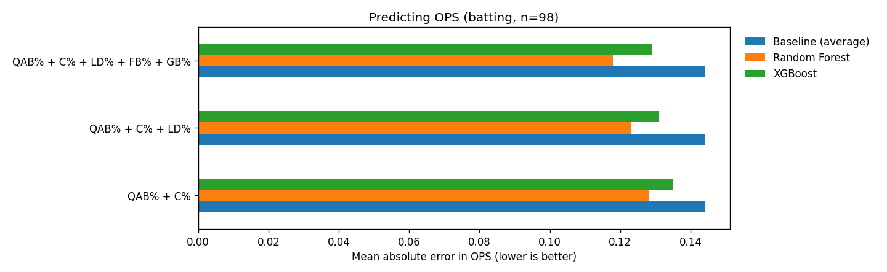
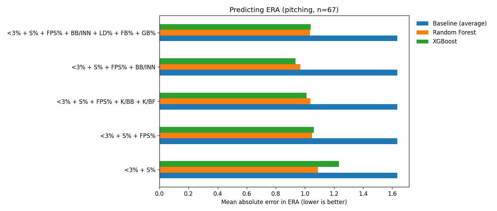

# Player Performance ML

Which stats a coach can actually influence (approach, contact, strike-throwing) best predict results for youth baseball players (14U–17U)?

I coach in the Mississauga Tigers High Performance Program, and we track every game in GameChanger. This project turns those season exports into models that predict a hitter's **OPS** and a pitcher's **ERA** from *process* stats, and ranks which stats matter most, so player-development time goes where it pays off.

**Built by:** James Markham (solo). Python, pandas, scikit-learn, XGBoost, matplotlib.

> **About the data:** the real stats belong to youth players (most are minors), so they never leave my computer. This repo ships a **synthetic dataset** with the same columns and similar spread (`src/make_synthetic.py`, invented players). The charts in `results/sample/` come from that synthetic data. The real-data findings below are aggregate numbers only.

## How it works
1. **Load and clean** (`src/load.py`). A GameChanger export stacks one block per team, each with its own header row and blank separator rows, and writes missing stats as `-`. The loader drops those rows, removes duplicate columns and converts everything to numbers.
2. **Filter small samples.** Hitters need 30+ plate appearances and pitchers 5+ innings, because OPS and ERA swing wildly over a handful of games.
3. **Compare feature sets** (`src/models.py`). For hitters: quality at-bat % (QAB%), contact % (C%), then batted-ball mix (LD%, FB%, GB%). For pitchers: strike %, first-pitch strikes, batters retired in 3 pitches or fewer (<3%), walks per inning and strikeout rates.
4. **Score honestly.** Each feature set is scored with a **Random Forest** and **XGBoost** using **5-fold cross-validation** (mean absolute error). The missing-value imputer sits inside the pipeline so no fold peeks at another's data. A **"predict the average" baseline** shows whether the stats carry real signal.
5. **Explain.** Random Forest feature importances show which stats the model leaned on.

## Findings on the real 2025 data (77 hitters, 56 pitchers)
| Target | Baseline error | Best model | Best error | Improvement |
|---|---|---|---|---|
| OPS | 0.152 | Random Forest, all 5 hitting stats | 0.124 | 18% better |
| ERA | 1.69 | Random Forest, <3% + S% + FPS% + K/BB + K/BF | 1.49 | 12% better |

- **Contact rate (C%) was the strongest single driver of OPS** (importance 0.51; correlation 0.55), ahead of quality at-bats.
- **Strike % and walks per inning drive ERA** (importance 0.33 each; correlations -0.61 and +0.63). Throwing strikes matters more than anything else on the list.
- **XGBoost didn't beat Random Forest.** With under 100 players per model, the simpler ensemble generalized better.
- **Limits:** one season, small samples, and youth stats are noisy (fielding, park, opponent quality). This is a coaching aid, not a scouting tool.

## Run it
```bash
pip install -r requirements.txt
python -m src.models              # runs on the synthetic sample data
```
Output: a comparison table and feature importances in the terminal, plus charts and CSVs in `results/sample/`.

**With your own team's data:** export season stats from GameChanger (batting and pitching CSVs), save them as `data/real/batting_stats.csv` and `data/real/pitching_stats.csv`, then run `python -m src.models --data data/real`. Both `data/real/` and `results/real/` are gitignored.

To regenerate the synthetic data: `python -m src.make_synthetic`.

## Sample output (synthetic data)



## Layout
```
src/load.py            clean a GameChanger export
src/models.py          feature-set comparison, cross-validation, feature importance, charts
src/make_synthetic.py  build the shareable sample data
data/sample/           synthetic CSVs (committed)
data/real/             real exports (gitignored)
results/sample/        charts and tables from the sample data
```
